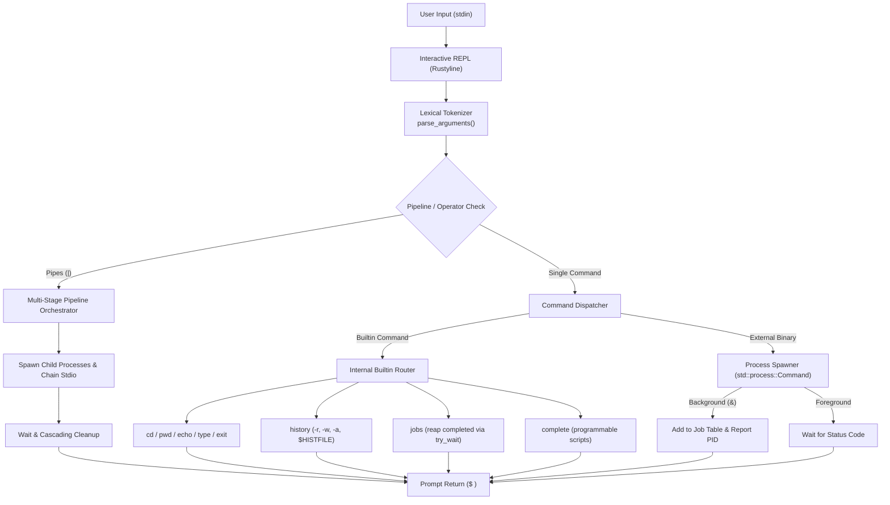

# Rush — POSIX-Compliant Shell in Rust

[](https://www.rust-lang.org/)
[]()
[]()

A high-performance, POSIX-aligned command interpreter and interactive REPL built from scratch in Rust. Features a custom state-machine tokenizer, multi-stage inter-process communication (IPC) pipelines, asynchronous background job supervision, stream redirection, and programmable tab-completion.

Designed to explore low-level systems programming: Unix process isolation (`fork`/`exec` semantics), file descriptor manipulation, IPC stream chaining, and non-blocking process polling in a memory-safe environment without garbage collection overhead.

---

## Architecture Overview

The shell follows a modular **REPL (Read-Eval-Print Loop)** architecture structured into discrete execution stages:



---

## Key Technical Features

### 1. State-Machine Lexical Tokenizer
* **Quote-Aware Parsing:** Deterministic finite-state scanner (`parse_arguments`) distinguishing single quotes (`'...'`), double quotes (`"..."`), and unquoted whitespace.
* **Escape Handling:** Context-aware backslash resolution preserving literals inside and outside quoted strings.
* **Zero-Copy Optimizations:** Leverages `std::mem::take` to extract token buffers without redundant heap allocations.

### 2. Multi-Stage IPC Pipelines (`|`)
* **Chained Process Streaming:** Intercepts pipeline tokens and connects the standard output of upstream processes directly to the standard input of downstream processes via anonymous pipes.
* **Cascading Process Cleanup:** On pipeline errors or non-existent binaries, automatically issues termination signals (`child.kill()`) and reaps child processes to eliminate zombie tasks.
* **In-Pipeline Builtin Execution:** Seamlessly handles builtins within pipeline chains by capturing in-memory buffers and routing them to the next process.

### 3. I/O Stream Redirection
* Supports full POSIX file descriptor routing for standard output (`>`, `1>`, `>>`, `1>>`) and standard error (`2>`, `2>>`) in both overwrite and append modes.
* Cleans and sanitizes redirection tokens before dispatching arguments to external commands.

### 4. Asynchronous Job Control & Concurrency (`&`)
* Spawns detached background processes and tracks them inside a thread-safe job table.
* Reports sequential job numbers and operating system process IDs (`[job_number] PID`).
* Implements non-blocking process polling via `try_wait()` before each prompt cycle to reap terminated children and display clean completion notices.

### 5. Interactive REPL & Programmable Autocompletion
* Line editing, history scrolling, and audio bell styles powered by `Rustyline`.
* **Smart Completion:** Dynamic path completion for files and directories, executable discovery across `$PATH` (validating `0o111` execution bits), and longest common prefix matching.
* **Programmable Hooks:** Dynamic completion script registration via the `complete` builtin passing `COMP_LINE` and `COMP_POINT` environment variables.
* **History Management:** Full support for persistent command logs via `$HISTFILE` and interactive flags (`history -r`, `-w`, `-a`).

---

## Architectural & Systems Design Highlights

* **In-Process vs. Subprocess Execution:** Builtins like `cd` and `history` execute directly within the shell process to manipulate parent process environment and state variables, which child sub-processes cannot alter.
* **Process Lifecycle & Zombie Prevention:** Implements non-blocking `try_wait` cycles during prompt loops to reap asynchronous background tasks and prevent zombie entries in the operating system process table.
* **Memory Safety & Error Propagation:** Eliminates common C-based shell pitfalls (buffer overflows, off-by-one errors, memory leaks) through Rust's strict ownership model, RAII file descriptor management, and typed `io::Result` propagation.

---

## Getting Started

### Prerequisites
* **Rust Toolchain:** Rust 1.80+ (2024 edition) and Cargo.
  ```sh
  curl --proto '=https' --tlsv1.2 -sSf https://sh.rustup.rs | sh
  ```

### Build and Run
```sh
# Clone the repository
git clone https://github.com/nikmos3/shell-rust.git
cd shell-rust

# Build in release mode
cargo build --release

# Run the shell
cargo run --release
```

---

## Example Usage

```sh
$ echo "Hello    world"
Hello world

$ ls -la | grep "main"
-rw-r--r--  1 developer  staff  36591 Oct 21 16:30 main.rs

$ echo "Logging output" > output.txt
$ cat output.txt
Logging output

$ sleep 5 &
[1] 49210

$ jobs
[1]+  Running                 sleep 5 &

$ history 5
    1  echo "Hello world"
    2  ls -la | grep "main"
    3  echo "Logging output" > output.txt
    4  cat output.txt
    5  sleep 5 &

$ exit
```

---

## Project Status & Roadmap

- [x] State-machine argument tokenization and quote escaping
- [x] POSIX builtin commands (`cd`, `pwd`, `echo`, `type`, `exit`)
- [x] Standard I/O and standard error redirection (`>`, `>>`, `2>`, `2>>`)
- [x] Multi-stage IPC command pipelines (`|`)
- [x] Asynchronous background process supervision (`&`) and job table
- [x] Interactive REPL with programmable tab-completion and `$HISTFILE`
- [x] Process signal handling & graceful termination (`SIGINT` / `EOF` break)
- [x] Dynamic environment variable and tilde home directory expansion

